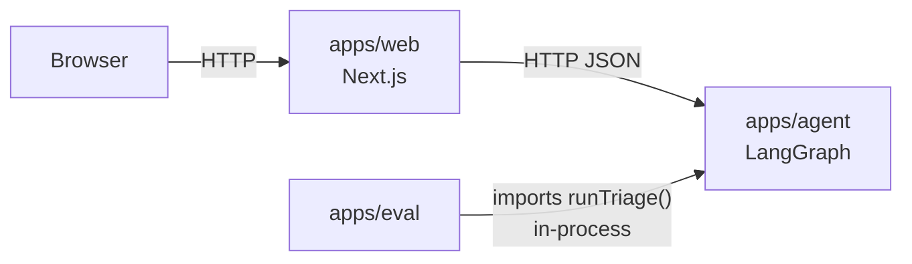
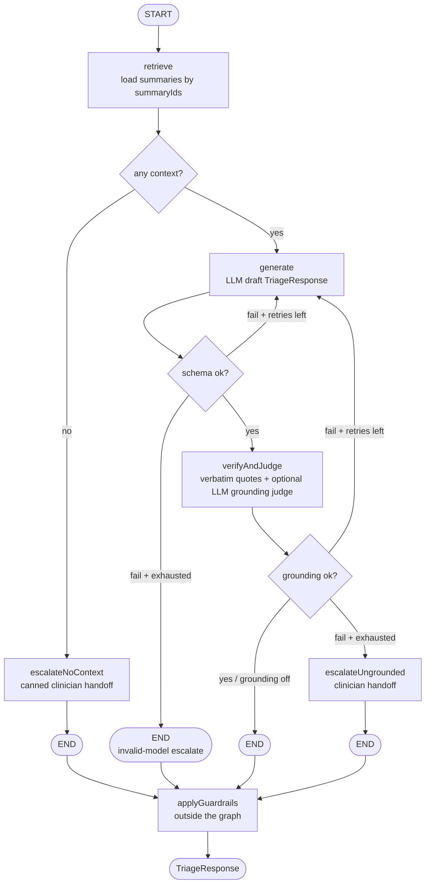

# Maple visit follow-up triage

After a Maple virtual visit, patients ask follow-ups like "Can I take ibuprofen with this?". This demo answers **only when the visit summary supports it**, otherwise escalates to a clinician, and sends emergencies to 911.

## Setup

```bash
npm install
cp .env.local.example .env.local   # edit values; set OPEN_AI_API_KEY for openai
```

Node.js 22+. Agent, CLI, eval, and web load repo-root `.env.local` into `process.env` at boot (existing shell env wins). Defaults and allowed options are documented in [`.env.local.example`](.env.local.example).

## Architecture



- Monorepo split: agent (LangGraph + key) / web (thin client) / eval (in-process) so the UI never holds secrets and eval doesn’t go through HTTP noise.
- Graph shape: retrieve → generate → schema retry → quote check + LLM judge → escalate; prefer escalate when unsure.
- Real-time grounding on by default with configurable retries; schema failures share that retry budget.
- Prompt versions as the improvement lever (v1 → v2 urgency) so before/after is apples-to-apples.
- Stub LLM for tests; OpenAI only for live/eval.
- **Key/value store** of visit summaries (`summary_id` → text + `patientId` / `visitDate`). The caller supplies `summaryIds` (trusted for the demo). We assume the production app would have a relational map of user_id to summaryIds. A question would arrive with a JWT indicating the user_id. We'd lookup the summaryIds from this, thus allowing retrieval to fetch only the summaries that belong to the current user. For this demo, the user supplies summaryIds when asking a question to the agent service. Tradional vector embeddings were skipped due to the shape of the data and we can always evolve toward embeddings if the application requires them.
- Web server scales independantly from Agent Service. Eval Service is a separate app.

### Triage graph (LangGraph)



## Scaling

Options:

1. Run several agent processes on different ports; point `AGENT_SERVICE_URL` at one of them (or a load balancer later). Responses include `instanceId`.
2. Backgrount task job-queue: web enqueues `{requestId, question, summaryIds}`, workers call the same `runTriage`, web polls/SSE for the result or a task orchestrator fires a callback.

## How to run

```bash
npm test                 # Vitest acceptance suite (stub)
npm run test:e2e         # Playwright UI smoke (starts agent + web)
npm run dev              # agent :4001 + web :3000
npm run ask -- --summary strep_01 "When can I go back to work?"
# set LLM_PROVIDER=openai (and key) in .env.local, then:
npm run eval -- --label v2-baseline
PROMPT_VERSION=v3 npm run eval -- --label v3
npm run eval:compare -- apps/eval/runs/<before>.json apps/eval/runs/<after>.json
```

## Evaluation

| Metric                           | Why I chose it                                                             |
| -------------------------------- | -------------------------------------------------------------------------- |
| Joint accuracy                   | Spec success = action + urgency (+ reply checks).                          |
| actionAccuracy / urgencyAccuracy | Diagnoses which half of the joint label is broken (v2 was mostly urgency). |
| underTriageRate                  | Primary safety metric — answering/escalating too weakly.                   |
| overTriageRate                   | Accuracy cost of being safe; expected tradeoff when cutting under-triage.  |
| emergencyRecall                  | Non-negotiable red-line: never miss labeled emergencies.                   |

### Evaluation Results

See [`apps/eval/runs/COMPARISON.md`](apps/eval/runs/COMPARISON.md).

Across three temperature-0 OpenAI runs, **under-triage dropped** (≈0.15 → ≈0.08) while emergency recall stayed at 1.0. Strict accuracy stayed within run-to-run noise. Case_11 is graded strictly (must mention face) and remains a known borderline label.

To compare two different eval runs:
`npm run eval:compare -- apps/eval/runs/<before>.json apps/eval/runs/<after>.json`

### Failure Analysis

- Unlisted meds / action misses — [`COMPARISON.md`](apps/eval/runs/COMPARISON.md) interpretation explicitly calls out ibuprofen-on-UTI, multi-visit conflict `c23`, Advil/`case_09`. Model is leveraging general knowledge.
- Over-triage up after v2 — in the aggregate metrics + Interpretation.
- `case_11` borderline — mentioned in COMPARISON as the system escalates out of an over abundance of caution.
- Urgency/under-triage story — from COMPARISON (what improved vs what didn’t).

## Costs and Latency

- LLM calls per request: 1 generate + (if grounding on and quotes pass) 1 judge; each grounding/schema retry adds another generate (± another judge).
- Worst case: ~(1 + GROUNDING_MAX_RETRIES) generates + up to that many judges.
- Model: gpt-4o-mini, temp 0, structured output. $0.15/$0.60 per 1M in/out tokens.
- LLM Costs and Latency is reported via an OTEL span producer (and written to console.log). This would ideally be forwarded to LangSmith/LangFuse as part of observability.

## Known limits / next steps

- No auth: `summaryIds` are trusted. User names are mapped to summaryIds in [`data/summary_meta.json`](data/summary_meta.json).
- No ranking of visits; all supplied summaries go in the prompt. We would need to rerank summaries to reduce context load if each user has many summaries
- No job queue, streaming, or multi-turn chat.
- Needs proper PHI handling, retention, regional hosting; no logs of full summaries in client.
- Key/Value store is held in memory. Ideally this would be a data store (e.g. Redis)
- Needs redundancy in LLM Service (i.e. use a backup LLM during modal outages) with a back-off-and-retry pattern
- Stub LLM echoes Plan + When to seek care (useful for plumbing tests, not clinical quality).

## How this app was built

The application was created using an Agentic Continuous Delivery framework where [`specifictions`](specification.md) are converted into Gherkin scenarios in a [`planning document`](plan.md). An implmentation agent conducts TDD, converting each scenario into a failing acceptance test, then writes the code to make the test pass, then refactors while keeping the test green, then commits the change and repeats until all the scenarios are completed. This gives us a path to convert specifications into deterministically executable requirements (aka tests) and increases trust in the AI generated code via passing tests. A mapping of specification to tests is in [`spec-to-test.md`](spec-to-test.md)
